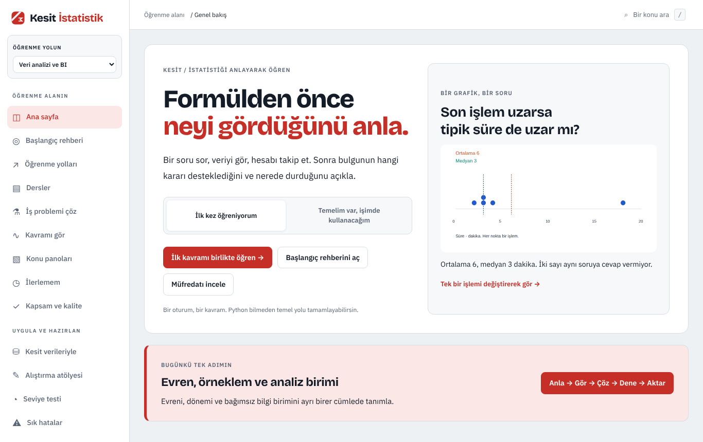
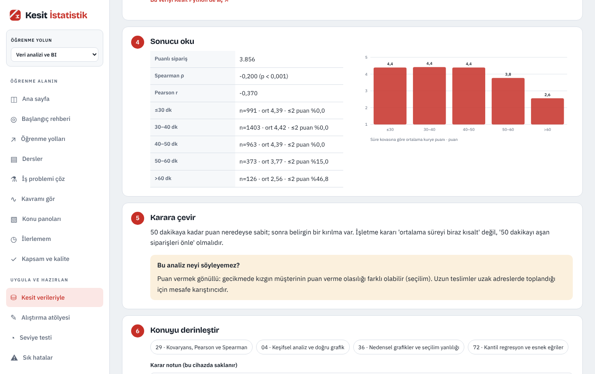
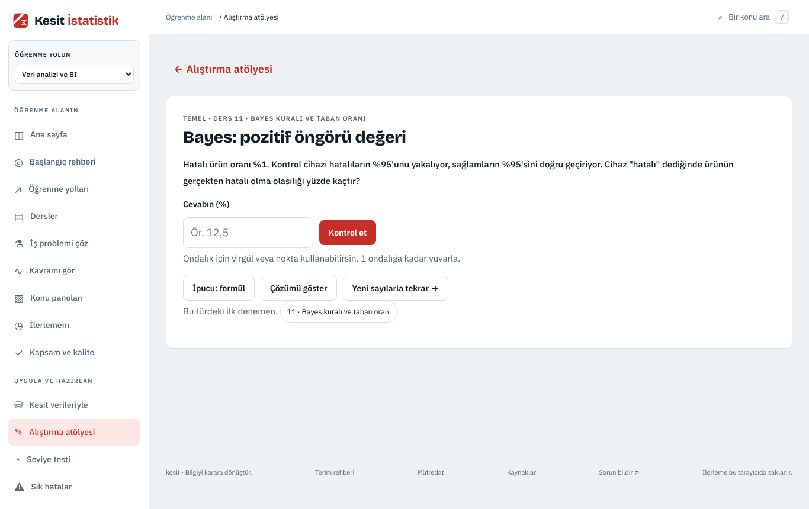
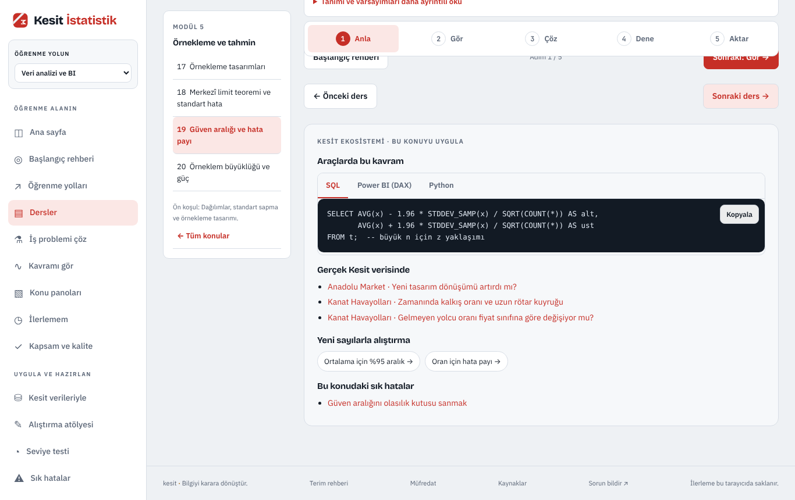

# Kesit İstatistik

**Sıfırdan ileri seviyeye Türkçe istatistik eğitimi. Kurulum yok, hesap yok.** Formülden önce veriyi görürsün; hesabı adım adım takip eder, sonucu bir iş kararına ve o kararın sınırlarına çevirirsin.

**Dene:** https://ysfdurak.github.io/kesit-istatistik/



## Neler var?
- **30 modülde 120 ders ve 8 seçmeli yöntem dersi.** Evren ve örneklemden başlar; testler, regresyon, deney, zaman serileri, Bayes, kalite, istatistiksel öğrenme ve nedensel çıkarıma uzanır. Temel, Orta ve İleri seviyeler.
- **4 öğrenme yolu:** veri analizi ve BI, veri bilimi, makine öğrenmesi, süreç ve kalite analizi.
- **Kesit verileriyle 13 vaka (V9):** Kesit SQL, Power BI ve Python'daki ortak kurgusal veri setlerinde (Anadolu Market, Lezzet Kurye, Kanat Havayolları, Pusula İK, Pedal İzmir, Ilgaz Bank) istatistik soruları. Her vakada tahmin, yöntem seçimi, **SQL + Python + DAX** kodu, gerçek veriden hesaplanmış sonuç, grafik, karar ve sınırlar.
- **Alıştırma atölyesi (V9):** 33 soru türü her açılışta yeni sayılar üretir; formül ipucu, adım adım çözüm, zayıf konular listesi ve karışık 10 soruluk setler.
- **Seviye testi, 32 sık hata ve 48 mülakat sorusu (V9).** Mülakat soruları yalnızca istatistik ve role göre; güçlü cevabın unsurları, zayıf cevap örneği ve takip sorusu.
- 34 tarayıcı atölyesi, 14 iş vakası, 28 hazır analiz senaryosu, 50 kavram keşfi, konu panoları ve indirilebilir Python defterleri.

| Kesit verisiyle vaka | Alıştırma atölyesi | Ders ve araç köprüsü |
|---|---|---|
|  |  |  |

## Kesit ekosistemi
Aynı mantıkla hazırlanmış kardeş eğitimler: **[Kesit SQL](https://ysfdurak.github.io/kesit-sql/)**, **[Kesit Power BI](https://ysfdurak.github.io/kesit-powerbi/)** ve **[Kesit Python](https://ysfdurak.github.io/kesit-python/)**. Önerilen akış: SQL ile veriyi hazırla → Python ile test et → Power BI ile raporla → istatistikle yorumla. Kesit İstatistik'teki vakalar, kardeş uygulamalardaki CSV'lerin aynısını kullanır; Python kodları veriyi doğrudan [kesit-python](https://github.com/ysfdurak/kesit-python/tree/main/data) deposundan okur. İlgili derslerin sonunda ayrıca o kavramın SQL, DAX ve Python karşılığı bulunur.

## Nasıl çalışıyor?
- Sunucu yok: HTML, CSS ve JavaScript; hesaplar tarayıcıda çalışır. Ders içi hesaplayıcılar SciPy referanslarıyla, vaka sonuçları pandas/scipy/statsmodels ile üretilir ve otomatik denetimlerle karşılaştırılır.
- İlerleme yalnızca kullanıcının tarayıcısında saklanır; **İlerlemem** sayfasından dosyaya kaydedilip başka cihazda birleştirilerek yüklenebilir (alıştırma, vaka ve mülakat kayıtları dahil). Kişisel veri toplanmaz.
- İlk ziyaretten sonra service worker dosyaları önbelleğe alır; internet yokken son kopya açılır. Yazı tipleri siteyle birlikte sunulur.

## Kendi bilgisayarında açma
```sh
python3 -m http.server 8000 --bind 127.0.0.1 --directory docs
```
Sonra [127.0.0.1:8000](http://127.0.0.1:8000/) adresini aç. Windows'ta `py -m http.server ...`.

## Kaynak, üretim ve denetim
- Yayınlanan site `docs/` klasöründedir (GitHub Pages: `main` dalı, `/docs`; kökteki `index.html` oraya yönlendirir).
- Kök dizindeki Python betikleri içerik ve referans üretir. Yapı, dosyaların görevi ve yeniden üretim sırası: **[NASIL.md](NASIL.md)**.
- Denetim: `node verify.cjs`, `node verify-engine.cjs`, `node verify-visual.cjs`, `node verify-quality.cjs`, `node verify-v9.cjs`. GitHub Actions her değişiklikte hepsini çalıştırır.
- [Sürüm notları](research/surum-notlari.md) · [V9 değerlendirme raporu](research/degerlendirme-v9.md)

## Yapay zekâ kullanımı
Ürün kararlarını, hedef kitleyi ve kapsamı Yusuf Durak belirledi; kod ve içerik yapay zekâ (Claude) ile geliştirildi ve otomatik denetimlerden geçirildi. Gerçek öğrenci pilotu veya bağımsız uzman incelemesi yapılmadı.

## Geri bildirim
Hata ve önerileri bu deponun [Issues](https://github.com/ysfdurak/kesit-istatistik/issues) sayfasına yazabilirsin; uygulamanın alt bilgisindeki **Sorun bildir** bağlantısı da oraya açılır.

## Sorumluluk notu
Ücretsiz, ticari olmayan bir eğitim ve portföy projesidir; içerik “olduğu gibi” sunulur. Veri setlerindeki tüm şirketler, kişiler ve kayıtlar hayalidir.

## Lisans
- Uygulama kodu: [MIT](LICENSE)
- Ders içerikleri ve veri setleri: [CC BY-NC 4.0](LICENSE-ICERIK.md)
- Yazı tipleri: Bricolage Grotesque, IBM Plex Sans, JetBrains Mono (SIL Open Font License; metinler `docs/vendor/fonts/` içinde)
